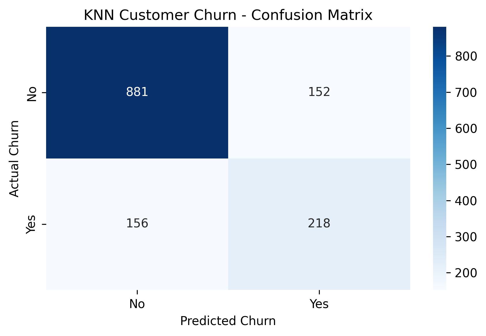
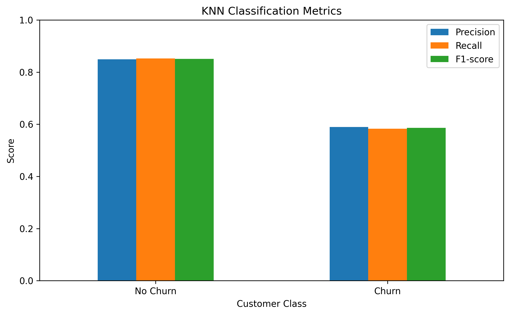
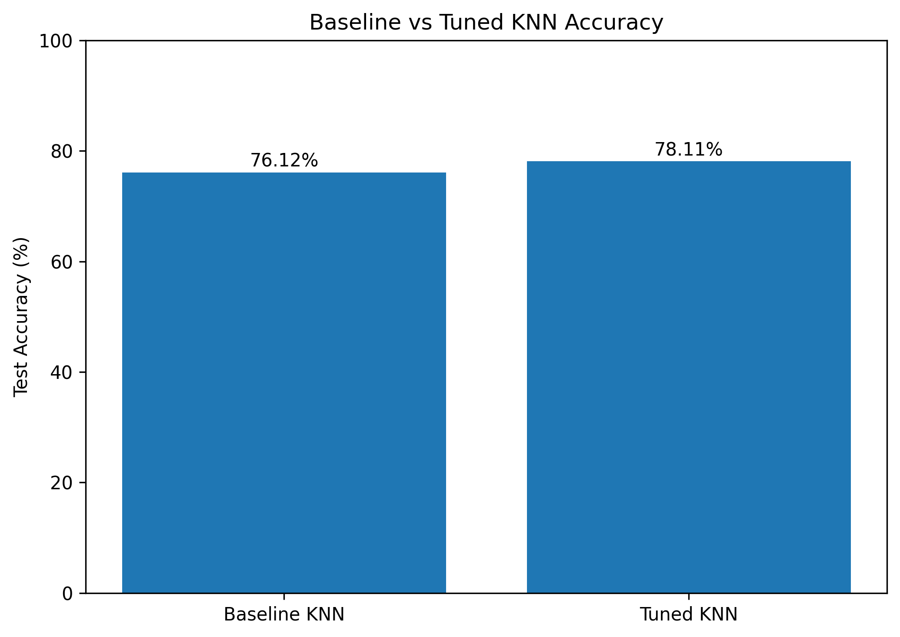

# Customer Churn Prediction Using K-Nearest Neighbors (KNN)

## Project Overview

This project predicts whether a telecommunications customer is likely to leave the company using the K-Nearest Neighbors (KNN) classification algorithm.

It uses customer information such as tenure, contract type, monthly charges, and service subscriptions to predict customer churn.

## Objectives

- Explore and preprocess customer data.
- Encode categorical features and scale numerical features.
- Build a KNN classification pipeline.
- Tune hyperparameters using GridSearchCV and stratified cross-validation.
- Evaluate the model using accuracy, precision, recall, F1-score, and a confusion matrix.
- Visualize model evaluation results.
- Save and reload the trained model.

## Dataset

The project uses the IBM Telco Customer Churn dataset.

- Original records: 7,043
- Records after removing missing `TotalCharges` values: 7,032
- Input features: 19
- Target variable: `Churn` (`Yes` or `No`)

## Technologies Used

- Python
- Pandas
- Scikit-learn
- Matplotlib
- Seaborn
- Joblib
- Jupyter Notebook

## Machine Learning Workflow

1. Load and explore the dataset.
2. Convert `TotalCharges` to numeric and remove rows with missing values.
3. Separate input features and target labels.
4. Split the data into training and testing sets (80:20).
5. Scale numerical features using `StandardScaler`.
6. Encode categorical features using `OneHotEncoder`.
7. Build a preprocessing and KNN pipeline.
8. Tune K and voting weights using `GridSearchCV` with five-fold stratified cross-validation.
9. Evaluate the tuned model on the held-out test set.
10. Visualize the confusion matrix and classification metrics.
11. Save and reload the trained pipeline using Joblib.

## Model Results

| Metric | Result |
|---|---:|
| Baseline test accuracy | 76.12% |
| Tuned test accuracy | 78.11% |
| Tuned churn precision | 0.59 |
| Tuned churn recall | 0.58 |
| Tuned churn F1-score | 0.59 |

The tuned model improved test accuracy by **1.99 percentage points** compared with the baseline model.

However, churn recall remained approximately 58%. This means the model identified about 58% of actual churn cases and missed a substantial proportion of customers who left.

These results demonstrate why accuracy alone is insufficient when evaluating a classification model with imbalanced classes.

## Visualizations

### 1. Confusion Matrix

The confusion matrix shows the number of correct and incorrect predictions for customers who churned and those who stayed.



### 2. Classification Metrics

This chart compares precision, recall, and F1-score for the churn and non-churn classes.



### 3. Baseline vs. Tuned Model Accuracy

This chart compares the test accuracy of the baseline KNN model with the tuned KNN model.



## Project Structure

```text
customer-churn-prediction-knn/
├── data/
│   └── Telco-Customer-Churn.csv
├── outputs/
│   ├── confusion_matrix.png
│   ├── classification_metrics.png
│   ├── model_comparison.png
│   └── knn_churn_model.pkl
├── customer_churn_knn.ipynb
├── requirements.txt
└── README.md
```

## How to Run

1. Clone or download this repository.
2. Install the dependencies:

   ```bash
   pip install -r requirements.txt
   ```

3. Open `customer_churn_knn.ipynb` in Jupyter Notebook or VS Code.
4. Run the notebook cells in order.

The trained model is saved at `outputs/knn_churn_model.pkl`.

## Limitations and Future Improvements

- Improve recall for the churn class.
- Compare KNN with Logistic Regression, Decision Tree, and Random Forest.
- Explore resampling methods where appropriate.
- Evaluate additional hyperparameters using cross-validation.
- Explore decision thresholds where supported by the model and evaluation workflow.
- Develop a simple interface for entering customer information and obtaining predictions.

## Conclusion

This project demonstrates an end-to-end machine learning workflow for customer churn prediction, including data preprocessing, feature encoding, feature scaling, model training, hyperparameter tuning, evaluation, visualization, and model persistence.

The tuned KNN model achieved **78.11% test accuracy**, with a churn F1-score of **0.59**. The evaluation also highlights the importance of improving churn detection rather than relying on accuracy alone.
